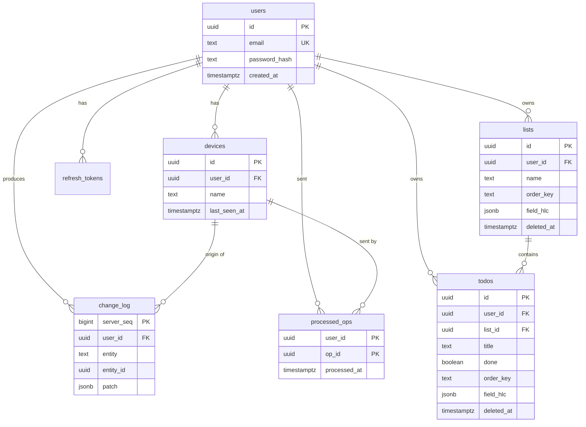

# ToDoness – Database Model

> Companion to [TechStack.md](./TechStack.md). It describes the two databases the
> offline-first design needs: **PostgreSQL** on the server (source of truth) and
> **IndexedDB / Dexie** in the browser (local working copy).

---

## 1. Design rules

| Rule | Reason |
|------|--------|
| Primary keys are **UUIDv7**, generated on the client | A task created offline already has its final ID. Time-ordered UUIDs index well. |
| **Soft delete** (`deleted_at`) instead of removing rows | Other devices must learn about deletions when they sync. |
| Every row has `user_id` | Every query is scoped to one user (multi-tenant safety). |
| Per-field **Hybrid Logical Clock** (`field_hlc`) | Enables per-field Last-Write-Wins without trusting device clocks. |
| `change_log` with an increasing `server_seq` | Clients pull changes with a simple cursor: `server_seq > since`. |
| `processed_ops` table | Makes `POST /sync/push` idempotent, so retries never create duplicates. |
| `order_key` is a fractional-index string | Reordering one task rewrites one row and cannot conflict. |
| Timestamps are `timestamptz` (UTC) | No time zone ambiguity. |

**HLC format:** a fixed-width, lexicographically sortable string
`<wall-ms 13 digits>-<counter 4 hex>-<client id>`, for example
`1730822400000-0003-c9f1a2`. Comparing two HLCs as plain strings gives the
correct order.

---

## 2. Entity relationship diagram



---

## 3. Server database (PostgreSQL 17)

> **Auth note:** if you use Better Auth, it creates and manages its own
> `user`, `session`, `account` and `verification` tables. In that case drop
> `users` and `refresh_tokens` below and point the `user_id` foreign keys at
> Better Auth's `user(id)` instead. The rest of the model is unchanged.

```sql
-- ============================================================
-- Extensions
-- ============================================================
CREATE EXTENSION IF NOT EXISTS citext;     -- case-insensitive e-mail

-- ============================================================
-- Users and authentication
-- ============================================================
CREATE TABLE users (
    id             uuid        PRIMARY KEY,                 -- UUIDv7 (app generated)
    email          citext      NOT NULL UNIQUE,
    password_hash  text        NOT NULL,                    -- argon2id
    display_name   text,
    created_at     timestamptz NOT NULL DEFAULT now(),
    updated_at     timestamptz NOT NULL DEFAULT now()
);

CREATE TABLE refresh_tokens (
    id             uuid        PRIMARY KEY,
    user_id        uuid        NOT NULL REFERENCES users(id) ON DELETE CASCADE,
    token_hash     text        NOT NULL UNIQUE,             -- store a hash, never the token
    expires_at     timestamptz NOT NULL,
    revoked_at     timestamptz,
    created_at     timestamptz NOT NULL DEFAULT now()
);
CREATE INDEX refresh_tokens_user_idx ON refresh_tokens (user_id);

-- One row per browser/device that syncs. `id` is the clientId sent in sync calls.
CREATE TABLE devices (
    id             uuid        PRIMARY KEY,
    user_id        uuid        NOT NULL REFERENCES users(id) ON DELETE CASCADE,
    name           text,                                    -- e.g. "Chrome on Android"
    last_seen_at   timestamptz NOT NULL DEFAULT now(),
    created_at     timestamptz NOT NULL DEFAULT now()
);
CREATE INDEX devices_user_idx ON devices (user_id);

-- ============================================================
-- Domain data (synced)
-- ============================================================
CREATE TABLE lists (
    id             uuid        PRIMARY KEY,                 -- client generated
    user_id        uuid        NOT NULL REFERENCES users(id) ON DELETE CASCADE,
    name           text        NOT NULL CHECK (char_length(name) BETWEEN 1 AND 200),
    color          text,                                    -- e.g. "#4f46e5"
    order_key      text        NOT NULL COLLATE "C",        -- fractional index
    field_hlc      jsonb       NOT NULL DEFAULT '{}'::jsonb,-- {"name":"<hlc>", ...}
    created_at     timestamptz NOT NULL DEFAULT now(),
    updated_at     timestamptz NOT NULL DEFAULT now(),
    deleted_at     timestamptz                              -- tombstone
);
CREATE INDEX lists_user_idx ON lists (user_id, order_key) WHERE deleted_at IS NULL;

CREATE TABLE todos (
    id             uuid        PRIMARY KEY,                 -- client generated
    user_id        uuid        NOT NULL REFERENCES users(id) ON DELETE CASCADE,
    list_id        uuid        NOT NULL REFERENCES lists(id) ON DELETE CASCADE,
    title          text        NOT NULL CHECK (char_length(title) BETWEEN 1 AND 500),
    notes          text        NOT NULL DEFAULT '',
    done           boolean     NOT NULL DEFAULT false,
    completed_at   timestamptz,                             -- set when done = true
    due_at         timestamptz,
    priority       smallint    NOT NULL DEFAULT 0 CHECK (priority BETWEEN 0 AND 3),
                                                            -- 0 none, 1 low, 2 medium, 3 high
    order_key      text        NOT NULL COLLATE "C",        -- fractional index within the list
    field_hlc      jsonb       NOT NULL DEFAULT '{}'::jsonb,-- {"title":"<hlc>","done":"<hlc>", ...}
    created_at     timestamptz NOT NULL DEFAULT now(),
    updated_at     timestamptz NOT NULL DEFAULT now(),
    deleted_at     timestamptz                              -- tombstone
);
CREATE INDEX todos_list_order_idx ON todos (user_id, list_id, order_key) WHERE deleted_at IS NULL;
CREATE INDEX todos_due_idx        ON todos (user_id, due_at)             WHERE deleted_at IS NULL AND done = false;
CREATE INDEX todos_tombstone_idx  ON todos (deleted_at)                  WHERE deleted_at IS NOT NULL;

-- ============================================================
-- Sync infrastructure
-- ============================================================

-- Append-only feed. Clients pull "everything with server_seq > my cursor".
CREATE TABLE change_log (
    server_seq     bigint      GENERATED ALWAYS AS IDENTITY PRIMARY KEY,
    user_id        uuid        NOT NULL REFERENCES users(id) ON DELETE CASCADE,
    device_id      uuid        REFERENCES devices(id) ON DELETE SET NULL,  -- who made it
    entity         text        NOT NULL CHECK (entity IN ('todo', 'list')),
    entity_id      uuid        NOT NULL,
    op_type        text        NOT NULL CHECK (op_type IN ('create', 'update', 'delete')),
    patch          jsonb       NOT NULL,                    -- the accepted field values
    hlc            text        NOT NULL,
    created_at     timestamptz NOT NULL DEFAULT now()
);
CREATE INDEX change_log_pull_idx ON change_log (user_id, server_seq);

-- Idempotency: every op id the server has already applied.
CREATE TABLE processed_ops (
    user_id        uuid        NOT NULL REFERENCES users(id) ON DELETE CASCADE,
    op_id          uuid        NOT NULL,                    -- = outbox opId from the client
    device_id      uuid        REFERENCES devices(id) ON DELETE SET NULL,
    processed_at   timestamptz NOT NULL DEFAULT now(),
    PRIMARY KEY (user_id, op_id)
);
CREATE INDEX processed_ops_age_idx ON processed_ops (processed_at);
```

### 3.1 Table summary

| Table | Purpose | Synced to client? |
|-------|---------|-------------------|
| `users` | Accounts | No |
| `refresh_tokens` | Long-lived login sessions | No |
| `devices` | One row per syncing browser (`clientId`) | No |
| `lists` | Task lists / projects | Yes |
| `todos` | Tasks | Yes |
| `change_log` | Ordered feed of accepted changes for pull | Read through `/sync/pull` |
| `processed_ops` | Idempotency keys for push | No |

### 3.2 Rules the server enforces

1. **Ordering of writes per user.** In each push transaction, first run
   `SELECT pg_advisory_xact_lock(hashtextextended(:user_id::text, 0))`.
   This serializes pushes of one user, so `server_seq` values become visible in
   order and a client cursor can never skip a row that commits late.
2. **Idempotency.** For each op: `INSERT INTO processed_ops ... ON CONFLICT DO NOTHING`.
   If nothing was inserted, the op was already applied. Acknowledge it again and
   skip it.
3. **Per-field Last-Write-Wins.** For each field in an op's `patch`, apply the
   value only if its HLC is greater than the HLC stored in `field_hlc` for that
   field. Then update `field_hlc`. Ties are broken by the client id inside the HLC.
4. **Delete vs. edit.** A delete sets `deleted_at` and wins over concurrent
   edits. Edits to a deleted row are stored but do not undelete it. A later
   explicit `restore` op (clears `deleted_at`, newer HLC) does.
5. **Ownership.** Every statement includes `user_id = :current_user`. A client
   can never write or read another user's rows. Reject any `list_id` that does
   not belong to the same user.
6. **Validation.** Allowed patch fields per entity are whitelisted and checked
   with the shared Zod schemas before touching the database.
7. **Change log.** Each applied op adds one `change_log` row containing only the
   fields that were actually accepted.

### 3.3 Cleanup jobs (scheduled, e.g. daily)

| Job | Rule |
|-----|------|
| Purge `processed_ops` | Delete rows older than 30 days. Clients must sync at least that often, or do a full resync. |
| Purge tombstones | Hard delete `todos` / `lists` with `deleted_at` older than 90 days **and** older than every active device's cursor. |
| Compact `change_log` | Delete entries older than 90 days. A client whose cursor is older than the oldest entry does a **full resync**. |
| Expire tokens | Delete `refresh_tokens` that are expired or revoked for more than 30 days. |

---

## 4. Client database (IndexedDB via Dexie)

```ts
db.version(1).stores({
  // primary key first, then indexed fields
  lists:       'id, updatedAt, deletedAt, orderKey',
  todos:       'id, listId, updatedAt, deletedAt, done, dueAt, [listId+orderKey]',
  outbox:      'opId, createdAt, entityId',     // pending changes, oldest first
  deadLetter:  'opId, failedAt',                // ops rejected by the server (4xx)
  meta:        'key',                           // clientId, lastServerSeq, schemaVersion, userId
});
```

```ts
type Hlc = string;   // see section 1

interface Todo {
  id: string;                    // UUIDv7
  listId: string;
  title: string;
  notes: string;
  done: boolean;
  completedAt: number | null;    // epoch ms
  dueAt: number | null;          // epoch ms
  priority: 0 | 1 | 2 | 3;
  orderKey: string;
  fieldHlc: Record<string, Hlc>; // per-field clock, same as the server
  createdAt: number;
  updatedAt: number;
  deletedAt: number | null;
}

interface List {
  id: string;
  name: string;
  color: string | null;
  orderKey: string;
  fieldHlc: Record<string, Hlc>;
  createdAt: number;
  updatedAt: number;
  deletedAt: number | null;
}

interface OutboxOp {
  opId: string;                  // UUIDv7, idempotency key
  entity: 'todo' | 'list';
  entityId: string;
  type: 'create' | 'update' | 'delete' | 'restore';
  patch: Record<string, unknown>;// only the changed fields
  hlc: Hlc;
  attempts: number;
  createdAt: number;
}

interface DeadLetter extends OutboxOp {
  failedAt: number;
  reason: string;                // server validation message
}

// meta rows
// { key: 'clientId',       value: string }   // = devices.id on the server
// { key: 'lastServerSeq',  value: number }
// { key: 'schemaVersion',  value: number }
// { key: 'userId',         value: string }
```

### 4.1 Mapping server ↔ client

| Server column | Client field | Notes |
|---------------|--------------|-------|
| `snake_case` | `camelCase` | Converted in the sync layer only |
| `timestamptz` | epoch milliseconds (`number`) | Easy to compare and store |
| `field_hlc` (jsonb) | `fieldHlc` (object) | Identical content |
| `deleted_at` | `deletedAt` | UI hides rows where it is not `null` |
| `user_id` | – | Implicit, not stored on the client |
| `change_log.server_seq` | `meta.lastServerSeq` | Pull cursor |

### 4.2 Client rules

1. **Local write = one transaction:** update `todos` or `lists` **and** append to
   `outbox` together, so they never get out of step.
2. **Applying pulled changes:** skip any field that still has a pending op in
   `outbox` for the same entity (the local edit will win or be merged on push).
3. **Queries hide tombstones:** always filter `deletedAt === null` in the UI.
4. **Schema changes:** bump `db.version(n)` and add a Dexie `upgrade()` step.
   Never edit an old version block.
5. **Logout:** clear all tables (warn first if `outbox` is not empty).

---

## 5. Sync protocol payloads

**Push** – `POST /sync/push`

```json
{
  "clientId": "0192f0c1-...",
  "ops": [
    {
      "opId": "0192f0c2-...",
      "entity": "todo",
      "entityId": "0192f0c3-...",
      "type": "update",
      "patch": { "done": true, "completedAt": 1730822400000 },
      "hlc": "1730822400000-0003-c9f1a2"
    }
  ]
}
```

Response:

```json
{ "accepted": ["0192f0c2-..."], "rejected": [{ "opId": "...", "reason": "..." }] }
```

**Pull** – `GET /sync/pull?since=<lastServerSeq>&limit=500`

```json
{
  "changes": [
    {
      "serverSeq": 1042,
      "entity": "todo",
      "entityId": "0192f0c3-...",
      "type": "update",
      "patch": { "done": true },
      "hlc": "1730822400000-0003-c9f1a2"
    }
  ],
  "nextSeq": 1042,
  "hasMore": false
}
```

If `since` is older than the oldest `change_log` entry, the server answers
`410 Gone` and the client performs a **full resync** (download all non-deleted
lists and todos, then replace local data except the `outbox`).

---

## 6. Migrations

- Server: **Drizzle ORM** schema in `apps/api/src/db/schema.ts`; migrations
  generated with `drizzle-kit generate` and committed to `apps/api/src/db/migrations/`.
- Client: Dexie versioned `stores()` blocks with `upgrade()` callbacks, in
  `apps/web/src/db/`.
- Changing a synced field means updating **both** databases and the shared Zod
  schema in `packages/shared`. Make the server accept the new field first,
  then ship the client.

---

## 7. Possible future extensions

| Feature | Model change |
|---------|--------------|
| Tags / labels | `tags` table + `todo_tags (todo_id, tag_id)`; junction rows sync as their own entity |
| Subtasks | `todos.parent_id uuid REFERENCES todos(id)` |
| Recurring tasks | `todos.recurrence_rule text` (RFC 5545 RRULE) |
| Sharing lists | `list_members (list_id, user_id, role)` and change_log fan-out per member |
| Attachments | `attachments` table + object storage (S3 / R2), uploaded after sync |
| Reminders | `reminders (id, todo_id, remind_at)` and Web Push subscriptions |
