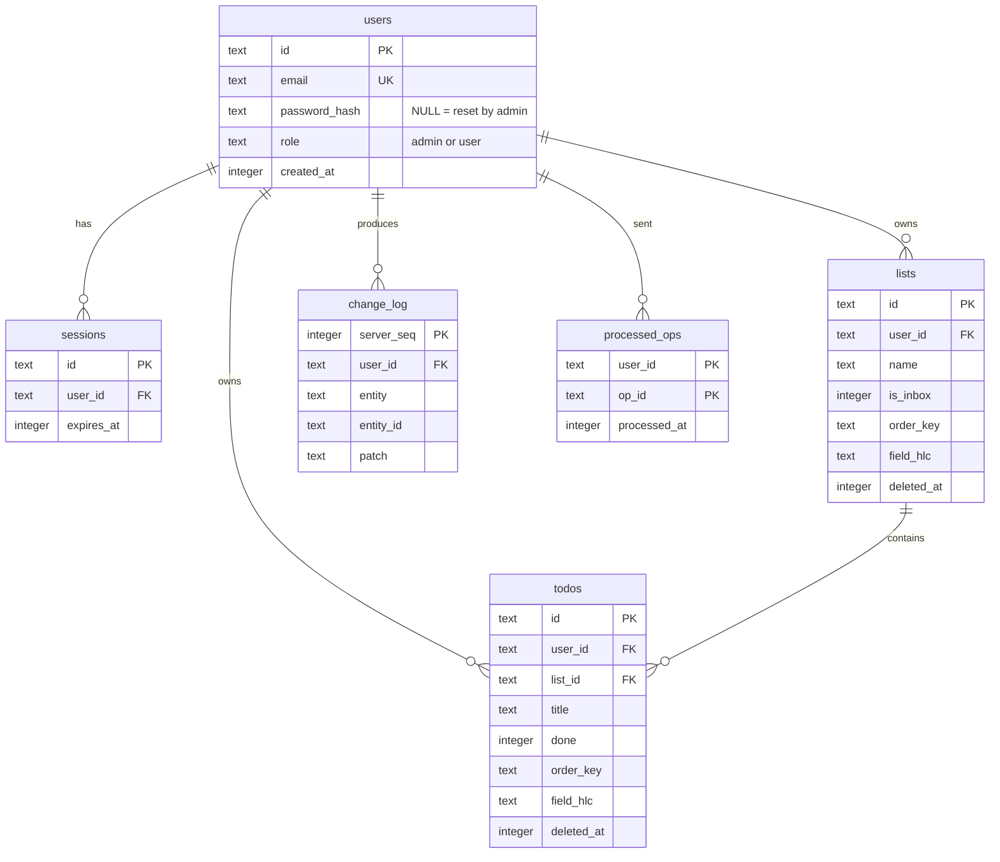

# ToDoness – Database Model

> Companion to [TechStack.md](./TechStack.md). It describes the two databases the
> offline-first design needs: **SQLite** on the server (source of truth) and
> **IndexedDB / Dexie** in the browser (local working copy).
>
> **Version 2:** moved from PostgreSQL to SQLite, removed the `devices` and
> `refresh_tokens` tables, and added an admin role and a password-reset state.

---

## 1. Design rules

| Rule | Reason |
|------|--------|
| Primary keys are **UUIDv7 text**, created on the client | A task created offline already has its final ID. Time-ordered IDs index well. |
| **Soft delete** (`deleted_at`) instead of removing rows | Other devices must learn about deletions when they sync. |
| Every row has `user_id` | Every query is limited to one user. |
| Per-field **Hybrid Logical Clock** (`field_hlc`) | Enables per-field "last write wins" without trusting device clocks. |
| `change_log` with an increasing `server_seq` | Clients pull changes with a simple cursor: `server_seq > since`. |
| `processed_ops` table | Makes `POST /sync/push` safe to repeat, so retries never create duplicates. |
| `order_key` is a fractional-index string | Reordering one task rewrites one row and cannot conflict. |
| Timestamps are **epoch milliseconds** (`INTEGER`, UTC) | The same format on the server and the client. |
| Booleans are `INTEGER` 0 / 1 | SQLite has no boolean type. |
| JSON is stored as `TEXT` | SQLite JSON functions can read it when needed. |
| Tables are `STRICT`, foreign keys are on, WAL mode | Type safety, integrity, and good read/write behaviour. |

**HLC format:** a fixed-width, sortable string
`<wall-ms 13 digits>-<counter 4 hex>-<client id>`, for example
`1730822400000-0003-c9f1a2`. Comparing two HLCs as plain strings gives the
correct order.

---

## 2. Entity relationship diagram



---

## 3. Server database (SQLite)

Applied as numbered migration files in `server/src/db/migrations/` (`001_init.sql`
is the schema below; the build copies them to `server/dist/migrations/`). Run these pragmas when the connection opens:

```sql
PRAGMA journal_mode = WAL;
PRAGMA foreign_keys = ON;
PRAGMA busy_timeout = 5000;
```

```sql
-- ============================================================
-- Users and sessions
-- ============================================================
CREATE TABLE users (
    id             TEXT    PRIMARY KEY,                    -- UUIDv7 (app generated)
    email          TEXT    NOT NULL COLLATE NOCASE UNIQUE,
    password_hash  TEXT,                                   -- argon2id; NULL = admin reset it,
                                                           -- next login sets the new password
    role           TEXT    NOT NULL DEFAULT 'user' CHECK (role IN ('admin', 'user')),
    created_at     INTEGER NOT NULL,                       -- epoch ms
    updated_at     INTEGER NOT NULL
) STRICT;

CREATE TABLE sessions (
    id             TEXT    PRIMARY KEY,                    -- hash of the random cookie value
    user_id        TEXT    NOT NULL REFERENCES users(id) ON DELETE CASCADE,
    expires_at     INTEGER NOT NULL,                       -- epoch ms (90 days)
    created_at     INTEGER NOT NULL
) STRICT;
CREATE INDEX sessions_user_idx ON sessions (user_id);

-- ============================================================
-- Domain data (synced to the browser)
-- ============================================================
CREATE TABLE lists (
    id             TEXT    PRIMARY KEY,                    -- created on the client
    user_id        TEXT    NOT NULL REFERENCES users(id) ON DELETE CASCADE,
    name           TEXT    NOT NULL CHECK (length(name) BETWEEN 1 AND 200),
    is_inbox       INTEGER NOT NULL DEFAULT 0 CHECK (is_inbox IN (0, 1)),
    order_key      TEXT    NOT NULL COLLATE BINARY,        -- fractional index
    field_hlc      TEXT    NOT NULL DEFAULT '{}',          -- JSON {"name":"<hlc>", ...}
    created_at     INTEGER NOT NULL,
    updated_at     INTEGER NOT NULL,
    deleted_at     INTEGER                                 -- marker for deleted rows
) STRICT;
CREATE INDEX lists_user_idx ON lists (user_id, order_key) WHERE deleted_at IS NULL;
-- At most one Inbox per user.
CREATE UNIQUE INDEX lists_one_inbox_idx ON lists (user_id) WHERE is_inbox = 1 AND deleted_at IS NULL;

CREATE TABLE todos (
    id             TEXT    PRIMARY KEY,                    -- created on the client
    user_id        TEXT    NOT NULL REFERENCES users(id) ON DELETE CASCADE,
    list_id        TEXT    NOT NULL REFERENCES lists(id) ON DELETE CASCADE,
    title          TEXT    NOT NULL CHECK (length(title) BETWEEN 1 AND 500),
    notes          TEXT    NOT NULL DEFAULT '',
    done           INTEGER NOT NULL DEFAULT 0 CHECK (done IN (0, 1)),
    completed_at   INTEGER,                                -- set when done = 1
    due_at         INTEGER,                                -- epoch ms
    priority       INTEGER NOT NULL DEFAULT 0 CHECK (priority BETWEEN 0 AND 3),
                                                           -- 0 none, 1 low, 2 medium, 3 high
    order_key      TEXT    NOT NULL COLLATE BINARY,        -- fractional index within the list
    field_hlc      TEXT    NOT NULL DEFAULT '{}',          -- JSON {"title":"<hlc>", ...}
    created_at     INTEGER NOT NULL,
    updated_at     INTEGER NOT NULL,
    deleted_at     INTEGER                                 -- marker for deleted rows
) STRICT;
CREATE INDEX todos_list_order_idx ON todos (user_id, list_id, order_key) WHERE deleted_at IS NULL;
CREATE INDEX todos_due_idx        ON todos (user_id, due_at)             WHERE deleted_at IS NULL AND done = 0;

-- ============================================================
-- Sync infrastructure
-- ============================================================

-- Append-only feed. Clients pull "everything with server_seq > my cursor".
CREATE TABLE change_log (
    server_seq     INTEGER PRIMARY KEY AUTOINCREMENT,
    user_id        TEXT    NOT NULL REFERENCES users(id) ON DELETE CASCADE,
    client_id      TEXT,                                   -- browser that sent the change
    entity         TEXT    NOT NULL CHECK (entity IN ('todo', 'list')),
    entity_id      TEXT    NOT NULL,
    op_type        TEXT    NOT NULL CHECK (op_type IN ('create', 'update', 'delete', 'restore')),
    patch          TEXT    NOT NULL,                       -- JSON: the accepted field values
    hlc            TEXT    NOT NULL,
    created_at     INTEGER NOT NULL
) STRICT;
CREATE INDEX change_log_pull_idx ON change_log (user_id, server_seq);

-- Repeat-safety: every operation id the server has already applied.
CREATE TABLE processed_ops (
    user_id        TEXT    NOT NULL REFERENCES users(id) ON DELETE CASCADE,
    op_id          TEXT    NOT NULL,                       -- = outbox opId from the client
    processed_at   INTEGER NOT NULL,
    PRIMARY KEY (user_id, op_id)
) STRICT, WITHOUT ROWID;
```

### 3.1 Table summary

| Table | Purpose | Synced to client? |
|-------|---------|-------------------|
| `users` | Accounts, role, password hash | No |
| `sessions` | Logged-in browsers (cookie sessions) | No |
| `lists` | Task lists | Yes |
| `todos` | Tasks | Yes |
| `change_log` | Ordered feed of accepted changes for pull | Read through `/sync/pull` |
| `processed_ops` | Keys that make push safe to repeat | No |

### 3.2 Rules the server enforces

1. **One writer at a time.** Each push runs in a `BEGIN IMMEDIATE` transaction.
   SQLite then allows only one writer, so `server_seq` values are visible in
   order and a client cursor can never skip a row that was committed late.
2. **Repeat safety.** For each operation: `INSERT OR IGNORE INTO processed_ops ...`.
   If no row was inserted, the operation was already applied. Report it as
   accepted again and skip it.
3. **Per-field "last write wins".** For each field in an operation's `patch`,
   apply the value only if its HLC is greater than the HLC stored in `field_hlc`
   for that field. Then update `field_hlc`. Ties are broken by the client ID
   inside the HLC.
4. **Delete vs. edit.** A delete sets `deleted_at` and wins over concurrent
   edits. Edits to a deleted row are stored but do not undelete it. A later
   `restore` operation (clears `deleted_at`, newer HLC) does.
5. **Ownership.** Every statement includes `user_id = :current_user`. Reject any
   `list_id` that does not belong to the same user.
6. **Validation.** Allowed patch fields per entity are whitelisted and checked
   with the shared Zod schemas before touching the database.
7. **Change log.** Each applied operation adds one `change_log` row containing
   only the fields that were accepted.

### 3.3 Accounts and admin

| Event | Database change |
|-------|-----------------|
| Register | Insert into `users`. If the table was empty, set `role = 'admin'`. Create the user's Inbox list (`is_inbox = 1`). |
| Log in | Check the argon2id hash and create a `sessions` row. |
| **Admin resets a password** | `UPDATE users SET password_hash = NULL` and `DELETE FROM sessions WHERE user_id = ?`. |
| **Log in after a reset** | If `password_hash IS NULL`, hash the password the user typed, store it, and log in. |
| Admin deletes a user | `DELETE FROM users WHERE id = ?`. Sessions, lists, todos, change log and processed operations are removed by `ON DELETE CASCADE`. |

### 3.4 Maintenance

At this size no clean-up jobs are needed. Rows marked as deleted, the change log
and `processed_ops` stay in the database. Delete expired `sessions` rows when the
server starts. Back up the database file every night with
`sqlite3 todoness.db ".backup backup.db"`.

---

## 4. Client database (IndexedDB via Dexie)

```ts
db.version(1).stores({
  // primary key first, then indexed fields. Only strings and numbers can be
  // indexed, so `deletedAt` (null) and the booleans are filtered in code.
  lists:       'id, orderKey',
  todos:       'id, listId, [listId+orderKey]',
  outbox:      'opId, hlc, entityId',   // pending changes; sent in `hlc` order (oldest first)
  deadLetter:  'opId, failedAt',        // changes the server rejected
  meta:        'key',                   // see the list below
});
```

```ts
type Hlc = string;   // see section 1

interface Todo {
  id: string;                    // UUIDv7
  listId: string;
  title: string;
  notes: string;
  done: boolean;
  completedAt: number | null;    // epoch ms
  dueAt: number | null;          // epoch ms
  priority: 0 | 1 | 2 | 3;
  orderKey: string;
  fieldHlc: Record<string, Hlc>; // per-field clock, same as the server
  createdAt: number;
  updatedAt: number;
  deletedAt: number | null;
}

interface List {
  id: string;
  name: string;
  isInbox: boolean;
  orderKey: string;
  fieldHlc: Record<string, Hlc>;
  createdAt: number;
  updatedAt: number;
  deletedAt: number | null;
}

interface OutboxOp {
  opId: string;                  // UUIDv7, repeat-safety key
  entity: 'todo' | 'list';
  entityId: string;
  type: 'create' | 'update' | 'delete' | 'restore';
  patch: Record<string, unknown>;// only the changed fields
  hlc: Hlc;
  attempts: number;
  createdAt: number;
}

interface DeadLetter extends OutboxOp {
  failedAt: number;
  reason: string;                // server validation message
}

// meta rows
// { key: 'clientId',        value: string }   // random ID for this browser, sent in sync calls
// { key: 'lastHlc',         value: string }   // last clock value produced here (never goes backwards)
// { key: 'lastServerSeq',   value: number }   // pull cursor
// { key: 'user',            value: { id, email, role } }  // who is logged in on this device
// { key: 'initialSyncDone', value: boolean }  // first full pull finished
// { key: 'pendingLogout',   value: boolean }  // logged out offline; tell the server at next start
```

### 4.1 Mapping server ↔ client

| Server column | Client field | Notes |
|---------------|--------------|-------|
| `snake_case` | `camelCase` | Converted in the sync layer only |
| `INTEGER` epoch ms | `number` | Same value, no conversion |
| `done`, `is_inbox` (0/1) | `boolean` | Converted in the sync layer |
| `field_hlc` (JSON text) | `fieldHlc` (object) | Same content |
| `deleted_at` | `deletedAt` | The UI hides rows where it is not `null` |
| `user_id` | – | Implicit, not stored on the client |
| `change_log.server_seq` | `meta.lastServerSeq` | Pull cursor |

### 4.2 Client rules

1. **A local change is one transaction:** update `todos` or `lists` **and** append
   to `outbox` together, so they never get out of step.
2. **Applying pulled changes:** merge them field by field with the shared
   `applyOp` ("last write wins" by clock). Local rows keep the clock of every
   field, so a newer pending local edit stays and an older one gives way. Do
   **not** skip fields that have pending operations: the server may keep the
   remote value, and the browser would then be left with a stale one.
3. **Queries hide deleted rows:** always filter `deletedAt === null` in the UI.
4. **Schema changes:** bump `db.version(n)` and add a Dexie `upgrade()` step.
   Never edit an old version block.
5. **Logout:** clear all tables (warn first if `outbox` is not empty). A `401`
   from the server is **not** a logout: keep the data and show the login screen.

---

## 5. Sync payloads

**Push** – `POST /api/sync/push`

```json
{
  "clientId": "c9f1a2",
  "ops": [
    {
      "opId": "0192f0c2-...",
      "entity": "todo",
      "entityId": "0192f0c3-...",
      "type": "update",
      "patch": { "done": true, "completedAt": 1730822400000 },
      "hlc": "1730822400000-0003-c9f1a2"
    }
  ]
}
```

Response:

```json
{ "accepted": ["0192f0c2-..."], "rejected": [{ "opId": "...", "reason": "..." }] }
```

**Pull** – `GET /api/sync/pull?since=<lastServerSeq>&limit=500`

```json
{
  "changes": [
    {
      "serverSeq": 1042,
      "entity": "todo",
      "entityId": "0192f0c3-...",
      "type": "update",
      "patch": { "done": true },
      "hlc": "1730822400000-0003-c9f1a2"
    }
  ],
  "nextSeq": 1042,
  "hasMore": false
}
```

A new device pulls with `since=0` and receives all data.

---

## 6. Migrations

- Server: numbered `.sql` files, applied in order at server start. Applied
  versions are tracked with `PRAGMA user_version`.
- Client: Dexie versioned `stores()` blocks with `upgrade()` callbacks.
- Changing a synced field means updating **both** databases and the shared Zod
  schema in `shared/`. Make the server accept the new field first, then ship the
  client.

---

## 7. Possible future extensions

| Feature | Model change |
|---------|--------------|
| Tags / labels | `tags` table + `todo_tags (todo_id, tag_id)`; junction rows sync as their own entity |
| Subtasks | `todos.parent_id TEXT REFERENCES todos(id)` |
| Recurring tasks | `todos.recurrence_rule TEXT` (RFC 5545 RRULE) |
| Sharing lists | `list_members (list_id, user_id, role)` and change-log delivery per member |
| Moving to PostgreSQL | Map `INTEGER` ms → `timestamptz`, `TEXT` JSON → `jsonb`, and use `bigint generated always as identity` for `server_seq` |
